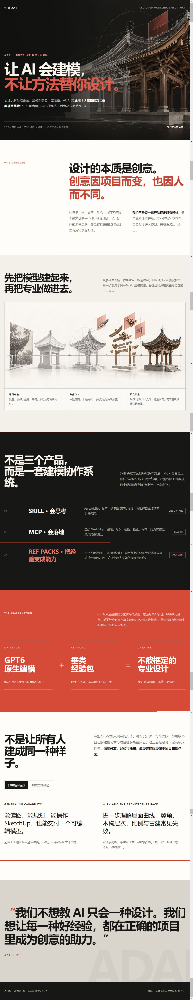

# SketchUp MCP + Skill for AI Modeling — ADAI

**SketchUp MCP + Skill for AI modeling agents.** Prompt-driven, editable 3D modeling with managed Ruby transactions, geometry readback, source-image review and local updates. Built for Codex and PipClaw on Windows; SketchUp 2018/2019 are listed targets, with native validation focused on 2019.

**adai-sketchup-skill-mcp** 将 SketchUp MCP 服务器与建模 Skill 配套提供，让 AI Agent 根据图片、CAD、文字或已有模型构造可编辑 SKP。Skill 提供当前怎么建、方法选择和看图纠错；MCP 执行受管写入、真实回读、原操作恢复与交付。由 ADAI 开发。

## 能力与工作方式

| 需要解决的问题 | 当前机制 | 使用边界 |
|---|---|---|
| 从来源构造完整建筑 | 通用轮廓、截面、曲面与实例方法；可选经验包和受管 Ruby | 根据来源选方法，预设不替代来源判断 |
| 分步建模或连续构造 | guided 图片/文字新建六阶段逐个执行审核；expert 使用连续工作单元 | 专家口令选择策略，不改变对象授权 |
| 改一处，保留其他成果 | `step` 定向更新目标及必要关联，支持已有墙洞/窗框联动 | 自定义 Ruby 可局部构造；不承诺任意拓扑自动修复 |
| 写入失败后可靠接续 | 事务、操作 ID、回执与未知结果恢复；已提交几何不因补取证而重放 | 先查原请求事实，再决定恢复动作 |
| 核对尺寸 | 可选来源尺寸目标与 SU 实测读回比较 | 当前为唯一对象的局部轴跨度及世界缩放，不是完整建筑约束求解器 |
| 检查实际效果 | 封存视图、原图对照、可选视角/近景、视觉 review | 程序校验证据归属；Agent 实际看图判断形态，不是自动相似度评分 |
| 交付可编辑文件 | `finish` 核对当前状态、证据与实际文件 | 保存成功、视觉符合来源、完成交付分别判断 |

MCP 对客户端使用 **stdio**；SketchUp 端通过本地 Ruby 桥接插件执行，默认桥接通道为文件。当前适配 Codex / PipClaw；其他 MCP 客户端需另行验证，不能据此宣称 Claude 已完成适配。

## 快速开始

1. 下载下面同构建的 Skill 和 MCP 两个 ZIP，准备 Windows、Node.js 18+、Python 3.10+ 及包内依赖。
2. 将 Skill 放入宿主技能目录；在宿主中配置 MCP 启动命令 `node`，参数为解压后 `launch.cjs` 的本机绝对路径，传输选择 stdio。完整配置见[安装说明](mcp/sketchup-managed-mcp/INSTALL.md)。
3. 在 SketchUp 扩展管理器安装 `mcp/sketchup-mcp/plugin/su_mcp.rbz`；保存已有工作后重启目标实例。
4. 向 Agent 提供本机 SketchUp.exe 的准确路径及全部来源图片，首次启动按返回动作完成绑定。

最小建模任务示例（附上图片，将路径替换为本机真实路径）：

```text
根据我上传的全部图片创建可编辑的 SketchUp 建筑模型。
以图片中的体量、比例、屋面和开敞空间为依据；未知部分合理推断并说明。
使用默认引导模式，六阶段逐个执行并看图纠错，最后交付 SKP。
SketchUp 程序路径：<本机 SketchUp.exe 的绝对路径>
输出目录：<本机输出目录的绝对路径>
```

guided 六阶段：**完整主形 → 代表构件 → 复制 → 变体 → 表皮细节 → 收尾**。不能合并或跳过；局部返修保留正确成果并接续进度。CAD、已有模型深化按各自保存路线执行。

## 安装

- [下载 Skill 0.5.39](dist/professional-sketchup-modeling-0.5.39-construction-inspection-20261003-r1.zip)
- [下载 MCP 0.5.39](dist/sketchup-managed-mcp-0.5.39-construction-inspection-20261003-r1.zip)
- [安装步骤](mcp/sketchup-managed-mcp/INSTALL.md) · [版本与验证范围](mcp/sketchup-managed-mcp/docs/COMPATIBILITY.md) · [SHA256 校验](SHA256SUMS.txt)

产品版本为 `0.5.39`；古建工具包 `0.4.7`、独立经验集合 `0.4.3`、默认古建 REF `1.4.0` 各自维护版本，不随主包改号。历史验证记录、旧安装包与校验表保存在 Git 历史中（[Gitee 历史安装包](https://gitee.com/laowang2026/adai-sketchup-skill-mcp/tree/4add79e345ffe6983e6cdbd73ba205f90ac61e35/dist) · [GitHub 历史安装包](https://github.com/laowang-wy/adai-sketchup-skill-mcp/tree/4add79e345ffe6983e6cdbd73ba205f90ac61e35/dist)）；旧版本测试不自动算作本次验证。安装包说明中提及的历史 `docs/RELEASE-*.md` 可在对应发布标签中查阅。

把 `skill/professional-sketchup-modeling` 复制到当前宿主的 Skill 目录：Codex 使用 `$CODEX_HOME/skills/`；PipClaw 使用其 `codex-home/skills/`。把 MCP 目录复制到用户本机的 MCP 目录，并让 PipClaw/Codex 的 MCP 配置指向该目录中的 `launch.cjs`。安装器应在本机生成路径；发行包不写死用户目录、SketchUp 路径、PID 或会话令牌。

首次运行只绑定用户明确指定的 SketchUp.exe。启动后先读取短卡、状态、ping 和模型摘要；未保存文档与多实例保护仍由 MCP 负责。

## 内置经验包与 GPT6 触发词

当前发行包只内置一个经验包：`adai-ancient-architecture`（古建，随 MCP 提供）。其他 REF 包需要按 [`docs/EXPERIENCE-PACKS.md`](docs/EXPERIENCE-PACKS.md) 单独加载；用户自建包不会被覆盖。

使用 GPT6 建模时，建议把下面任一行放在任务第一条非空行，以选择 v2 专家工作单元策略：自主组合构造、按需取证和合并审核：

```text
ADAI老王，开启专家模式
开启ADAI老王专家模式
```

这两个触发词选择 `autonomous` 执行策略；不放宽权限、真实成果要求或未知写入恢复屏障。旧项目保留原策略，不静默升级。使用其他模型时不需要触发词，默认 `guided` 模式即可。

## Agent 工具与 Skill 入口

使用真实工具名与服务器返回的 `inputSchema`，无需猜测 `create_wall` 等别名。常用入口如下：

| 工具 | 关键输入 | 返回与下一步 |
|---|---|---|
| `sketchup_runtime` | `action=startup`；首次绑定用户提供的程序路径 | 当前实例、启动短卡与下一动作 |
| `sketchup_project_begin` | `task_text`、`mode`、输出目录；图片任务传全部 `source_images` | 项目、保存策略和当前构造方法 |
| `sketchup_project_step` | `project_id`；`ruby_file` 或 `operations` 二选一 | 操作结果、回执身份；guided 通常同时取证，expert 可连续构造 |
| `sketchup_project_geometry_diagnose` | 项目及可选名称线索/目标 | 真实对象地址与局部修改帮助 |
| `sketchup_project_retry_evidence` | 项目及可选 `views`、`comparison` | 当前视图/对照图，不重建几何 |
| `sketchup_project_review` | 证据 ID、结论、实际视觉观察 | 当前审核结果及下一动作 |
| `sketchup_project_operation_receipt` / `sketchup_project_recover` | 原项目/操作与恢复动作 | 原请求事实及可执行恢复结果 |
| `sketchup_project_finish` | 已完成审核的项目 | 实际交付文件与状态 |

类型化 `wall`、`window_frame` 等是 `step.operations` 中的操作，不是单独 MCP 工具。类型化长度及 `context['geometry']` 构造方法输入为 **毫米**；直接调用 SketchUp Ruby API 时须处理原生英寸，详见[受管 Ruby API](skill/professional-sketchup-modeling/references/managed-ruby-api.md)。

Skill 名称保持 `professional-sketchup-modeling`：[入口全文](skill/professional-sketchup-modeling/SKILL.md) · [引导模式](skill/professional-sketchup-modeling/references/guided-operation.md) · [专家模式](skill/professional-sketchup-modeling/references/expert-operation.md) · [局部修改](skill/professional-sketchup-modeling/references/scoped-operations.md)。

## 验证与适用范围

面向建筑主形、室内墙洞/窗框、立面构件、古建及已有受管模型局部修改。来源可为图片、CAD、文字或已有 SKP；输入资料仍需要 Agent 理解，当前不承诺自动 CAD 识图、工程量统计、木工连接专业验证或结构规范审查。

尺寸绑定需要真实依据，不能把未提供的尺寸当作实测。专家写入后会保守失效整体视觉结论；当前并非完整依赖图驱动的最小范围重检系统。工具成功、字段齐全和几何数量都不能代替与来源的形态比较。

当前发行版本 **0.5.39**，构建 `0.5.39-construction-inspection-20261003-r1`。发布时通过 301 项源码回归、136 份源码语法检查及运行包解压验证；协议测试使用明确标注的 SU 替身。同源功能有部分 SU2019 真机验证；最终包整栋建模、跨机器和实际 token/费用收益不在这些结果的保证范围。SketchUp 2018 在适配目录内；2021+ 不作为已验证兼容承诺。详见[构建说明](mcp/sketchup-managed-mcp/RELEASE.md)与[兼容性说明](mcp/sketchup-managed-mcp/docs/COMPATIBILITY.md)。

## 经验扩展与项目介绍

经验包独立安装、锁版和更新。当前只内置古建经验包，通用构造方法不局限古建；如何添加方法与 REF，见[经验包格式](docs/EXPERIENCE-PACKS.md)。



上图为项目介绍，不是当前版本的建模验收证据。目录简介与标签的统一文案见[项目简介](docs/PROJECT-LISTING.md)。

## 分发与更新

仓库提供 `skill/`、`mcp/` 与 `dist/` 中同构建的两个安装包。开发测试、用户模型、本机配置与凭据不随运行包分发；旧版本通过 Git 历史取得。运行更新同步构建标识、安装包及 SHA256；文档更新不代表运行构建已改变。

## 作者与许可

建筑建模 Skill 由 **ADAI 老王**提供。许可为 [CPAL-1.0](LICENSE)，归属要求见 [NOTICE](NOTICE)。ADAI 标识不写入 SKP 几何或隐藏模型属性。
